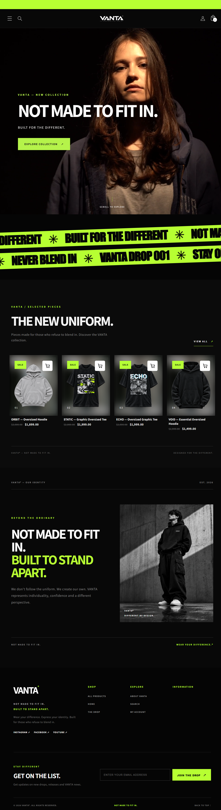
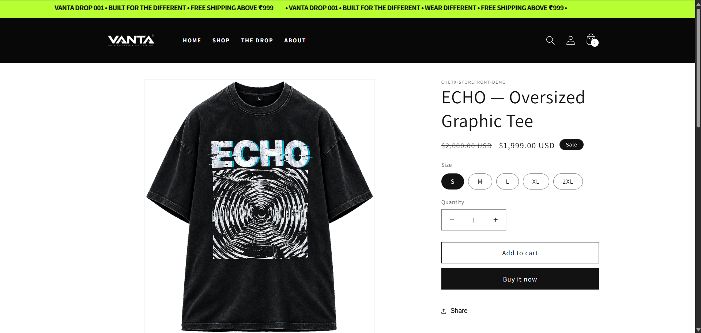
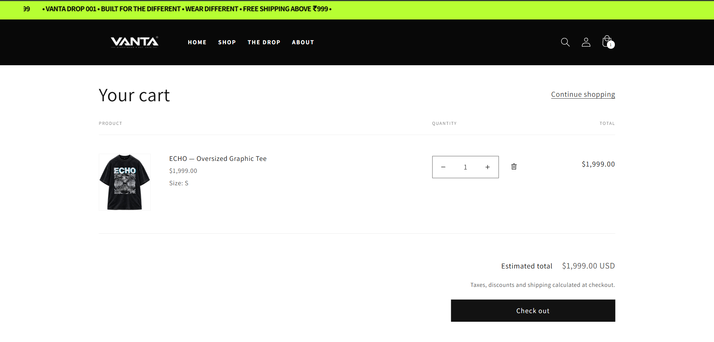

# V A N T A
### THE STREETWEAR ARCHIVE.

<p align="center">
  <strong>Started with a hoodie. Somehow ended up building an entire Shopify theme.</strong>
</p>

<p align="center">
  A custom streetwear storefront built with Shopify Liquid, CSS and JavaScript.
</p>

<p align="center">
  
  
  
</p>


<div align="center">
  <h2>THE STOREFRONT.</h2>
  <p>Looks good. Works too. Imagine that.</p>
</div>



<br>

<table>
  <tr>
    <td width="50%">
      
      <p align="center"><strong>PRODUCT EXPERIENCE</strong></p>
    </td>
    <td width="50%">
      
      <p align="center"><strong>THE CART ACTUALLY WORKS</strong></p>
    </td>
  </tr>
</table>


---

## THE IDEA

I wanted to build a streetwear website.

Not another default-looking online store with a product image, a price and a button.

I wanted something with a little attitude.

So here we are. Black backgrounds, lime accents, cinematic visuals, custom product cards and a ridiculous amount of attention to small details.

Was it necessary to spend so much time adjusting animations and spacing?

Probably not.

Did I do it anyway?

Absolutely.

## WHAT DID I BUILD?

| Feature | Details |
|---|---|
| Video Hero | Full-screen cinematic introduction |
| Announcement Bar | Animated lime ticker |
| Custom Header | Minimal navigation and clean interactions |
| Product Showcase | Dynamic Shopify product collections |
| Product Hover | Switches between isolated product and model images |
| Quick Add to Cart | Select a size and add directly from the homepage |
| Product Page | Custom product detail experience |
| Shop & Collections | Product browsing, filtering and sorting |
| Search | Shopify-powered product search |
| Cart | Cart drawer, quantity controls and removal |
| Brand Section | Custom VANTA identity |
| Footer | Custom dark footer and newsletter |
| Responsive Design | Made for desktop and mobile |

And yes, the buttons actually do things. I checked. Several times.

## THE LOOK

I kept the visual direction simple.

| Element | Colour |
|---|---|
| Background | `#050505` |
| Secondary Background | `#080808` |
| Lime Accent | `#B7FF32` |
| Main Text | `#FFFFFF` |
| Secondary Text | `#888888` |

Bold typography. High contrast. Clean layouts. Smooth motion.

Nothing too complicated. Just enough to make someone stop scrolling.

## THE TECH BEHIND IT

- Shopify Liquid
- HTML5
- CSS3
- JavaScript
- Shopify Ajax Cart
- JSON Templates
- Shopify Theme Architecture

## THE TECHNICAL HIGHLIGHTS

A few things behind the visuals. Because making it look good wasn't enough.

### 1. CUSTOM SHOPIFY SECTIONS
Built reusable homepage sections using Shopify Liquid, including the video hero, product showcase, brand identity and custom footer.

### 2. INTERACTIVE PRODUCT CARDS
Product cards use multiple product images to create a hover transition between the isolated product image and the lifestyle/model image.

### 3. AJAX QUICK ADD TO CART
Customers can select a product size directly from the homepage. The selected Shopify variant is added to the cart using AJAX, without navigating away from the page.

### 4. NATIVE SHOPIFY INTEGRATION
Product pages, collections, search, cart and checkout use Shopify's native functionality, keeping the storefront connected to real Shopify product data.

### 5. RESPONSIVE DESIGN
Custom styling adapts the storefront across desktop and mobile screens without losing the VANTA visual identity.

No magic here. Just code, debugging, experiments and occasionally wondering why one tiny CSS change broke something completely unrelated.

## PROJECT STRUCTURE

```text
VANTA/
│
├── assets/
│   └── base.css
│
├── config/
├── layout/
├── locales/
│
├── sections/
│   ├── chetx-product-main.liquid
│   ├── chetx-product-showcase.liquid
│   ├── chetx-video-hero.liquid
│   ├── vanta-brand-identity.liquid
│   ├── vanta-double-marquee.liquid
│   └── vanta-footer.liquid
│
├── snippets/
│
├── templates/
│   └── product.vanta.json
│
├── .gitignore
└── README.md
```

## WANT TO RUN IT?

You'll need:

- A Shopify development store
- Shopify CLI
- Git
- Node.js

Clone the repository:

```bash
git clone https://github.com/ChetanAngadi001/vanta-shopify-storefront.git
```

Enter the project:

```bash
cd vanta-shopify-storefront
```

Start the development server:

```bash
shopify theme dev --store your-store.myshopify.com
```

Replace the example domain with your own Shopify development store.

## BEFORE YOU THINK THIS IS A REAL BRAND...

Small clarification: VANTA is currently a portfolio project.

No warehouse. No delivery department. No actual hoodie empire.

Just a developer experimenting with Shopify, building things, breaking things and hopefully getting better at it.

## THE PERSON RESPONSIBLE

**Chetan Angadi**

Developer. Electronics student. Professional overthinker of tiny design details.

I like building things that look good, work properly and make people curious about how they were made.

If something can be improved, I'll probably spend another hour on it.

[GitHub Profile](https://github.com/ChetanAngadi001)
---

<p align="center">
  <strong>V A N T A</strong>
  <br/>
  THE STREETWEAR ARCHIVE.
  <br/><br/>
  <em>Too much attention to detail. Not enough reasons to stop.</em>
</p>